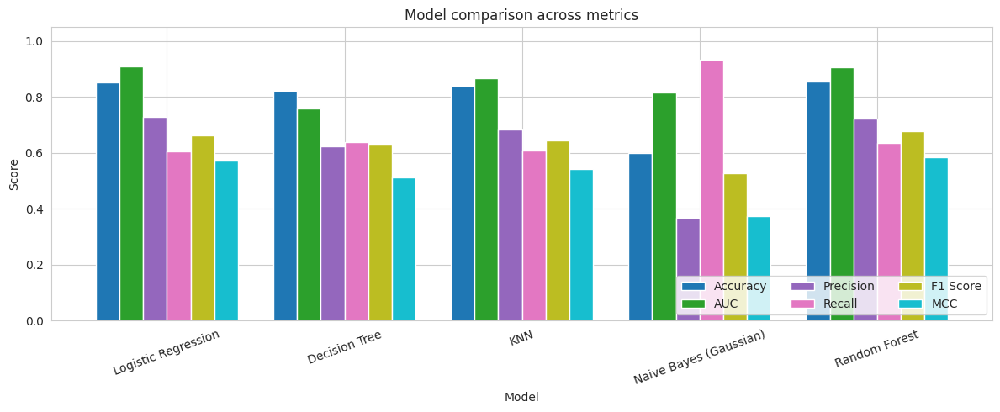
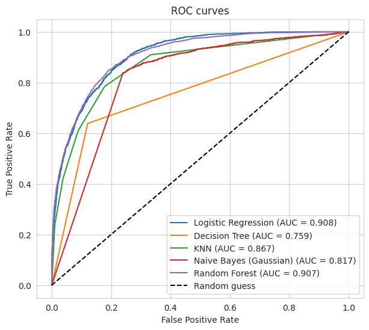
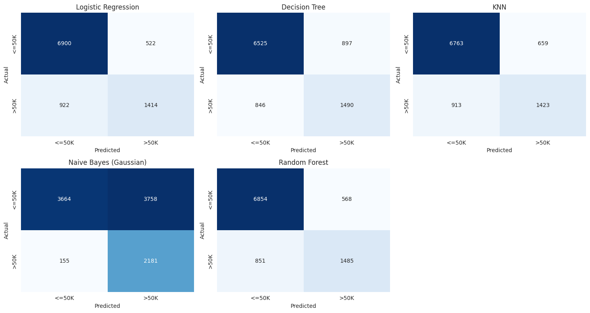

# ML Assignment 2: Income Classification (Adult Census Dataset)

**Name:** Kinjal Kanjilal  
**Roll No.:** 2026ct05111

---

## a. Problem Statement

The goal of this project is to build and compare five machine learning classification models that predict whether a person's annual income exceeds **$50K** based on demographic and employment attributes (age, education, occupation, hours worked per week, etc.).

This is a **binary classification** problem:
- Class `0`: income `<=50K`
- Class `1`: income `>50K`

All models are trained on the same preprocessed data and compared using Accuracy, AUC, Precision, Recall, F1 Score and Matthews Correlation Coefficient (MCC).

---

## b. Dataset Description

| Property | Details |
|---|---|
| **Name** | Adult (Census Income) |
| **Source** | UCI Machine Learning Repository: https://archive.ics.uci.edu/dataset/2/adult (also on Kaggle as "Adult Census Income") |
| **Instances** | 48,842 raw (UCI train and test files combined); **48,790** after removing 52 duplicate rows |
| **Features** | 14 (6 numerical, 8 categorical); 105 columns after one-hot encoding |
| **Target variable** | `income` (`<=50K` / `>50K`) |
| **Missing values** | `workclass` (2,799 / 5.73%), `occupation` (2,809 / 5.75%), `native-country` (857 / 1.75%), coded as `?` in the raw data |
| **Class distribution** | `<=50K`: 37,155 (76.07%), `>50K`: 11,687 (23.93%), an imbalance ratio of **3.18 : 1** (before duplicate removal) |

**Why this dataset?** It satisfies all assignment requirements (more than 12 features, more than 1,000 instances), contains real missing values, is imbalanced, and has a mix of numerical and categorical features, so every preprocessing step is meaningful.

**Features**
- *Numerical:* `age`, `fnlwgt`, `education-num`, `capital-gain`, `capital-loss`, `hours-per-week`
- *Categorical:* `workclass`, `education`, `marital-status`, `occupation`, `relationship`, `race`, `sex`, `native-country`

### Data Preprocessing

| Step | Method |
|---|---|
| Missing values | Identified per column. Categorical: most frequent value; numerical: median (`SimpleImputer`) |
| Duplicates | 52 exact duplicate rows removed before splitting |
| Encoding | Target encoded with `LabelEncoder` (`<=50K` = 0, `>50K` = 1); categorical features with `OneHotEncoder(handle_unknown="ignore")` |
| Scaling | `StandardScaler` on numerical features |
| Train-test split | 80:20 (39,032 train / 9,758 test), `stratify=y`, `random_state=42`. Class ratio is 76.06% / 23.94% in the full, train and test sets |
| Data leakage | All preprocessing (imputer, encoder, scaler) is fitted on the **training data only** via `ColumnTransformer`; test data is only transformed |

---

## c. GitHub Repository Link

https://github.com/2026ct05111/2026ct05111_ML_Assignment_2

```
2026ct05111_ML_Assignment_2/
├── classification_assignment.ipynb   # full notebook (EDA, preprocessing, models, evaluation)
├── requirements.txt                  # dependencies
├── README.md
├── model/
├── test_data.csv
└── images/               # plots used in this README
    ├── model_comparison.png
    ├── roc_curves.png
    └── confusion_matrices.png
```

---

## d. Models Used

### Model Configurations

| Model | Configuration |
|---|---|
| Logistic Regression | `max_iter=1000`, `random_state=42` |
| Decision Tree | `random_state=42` (default parameters) |
| kNN | `n_neighbors=5` |
| Naive Bayes | `GaussianNB` (default parameters) |
| Random Forest (Ensemble) | `n_estimators=200`, `random_state=42`, `n_jobs=-1` |

### Comparison Table

> Evaluated on the 20% test set (9,758 samples). Positive class = `>50K`. Best value in each column is in bold.

| ML Model Name | Accuracy | AUC | Precision | Recall | F1 | MCC |
|---|---|---|---|---|---|---|
| Logistic Regression | 0.8520 | **0.9081** | **0.7304** | 0.6053 | 0.6620 | 0.5724 |
| Decision Tree | 0.8214 | 0.7587 | 0.6242 | 0.6378 | 0.6310 | 0.5132 |
| kNN | 0.8389 | 0.8667 | 0.6835 | 0.6092 | 0.6442 | 0.5420 |
| Naive Bayes | 0.5990 | 0.8174 | 0.3672 | **0.9336** | 0.5271 | 0.3736 |
| Random Forest (Ensemble) | **0.8546** | 0.9072 | 0.7233 | 0.6357 | **0.6767** | **0.5854** |

### Visualizations

**Metric comparison across models**



**ROC curves**



**Confusion matrices**



### Observations on Model Performance

| ML Model Name | Observation about model performance |
|---|---|
| Logistic Regression | Strong and stable baseline. It has the highest AUC (0.9081) and highest precision (0.7304), and its accuracy (0.8520) is close to the best. Its recall for the `>50K` class is only 0.6053, so it misses about 4 in 10 high earners. Despite its simplicity, it matches the ensemble on ranking quality, which suggests the classes are largely linearly separable after scaling and one-hot encoding. |
| Decision Tree | Weakest of the non-probabilistic models: accuracy 0.8214, AUC 0.7587 (lowest of all five) and MCC 0.5132. With default settings the tree grows until its leaves are pure, which typically overfits the training data. Its probability outputs are also very coarse (mostly 0 or 1), which lowers AUC. It has slightly better recall (0.6378) than Logistic Regression, but at the cost of precision (0.6242). |
| kNN | Mid-range performance: accuracy 0.8389, AUC 0.8667, F1 0.6442. Scaling the numeric features helped, but one-hot encoding raised the dimensionality to 105 columns, and distances become less informative in high-dimensional sparse space. It beats the Decision Tree but trails Logistic Regression and Random Forest on every metric. It is also slower at prediction time, since it compares each test point against all training points. |
| Naive Bayes | Behaves very differently from the others. Recall is the highest (0.9336), meaning it catches almost all high earners, but precision is the lowest (0.3672) and accuracy is only 0.5990, so it labels many low earners as `>50K`. The independence assumption is violated here because features such as `marital-status` and `relationship` are strongly correlated and one-hot columns are mutually dependent. It has the lowest MCC (0.3736), so its high recall is not a sign of a good model overall. Its AUC (0.8174) shows the ranking is decent, but the default 0.5 threshold is poorly calibrated for it. |
| Random Forest (Ensemble) | Best overall. It has the highest Accuracy (0.8546), F1 (0.6767) and MCC (0.5854), and its AUC (0.9072) is within 0.001 of the best. Averaging 200 trees greatly reduces the variance of a single tree: AUC rises from 0.7587 (Decision Tree) to 0.9072 and MCC from 0.5132 to 0.5854. It also balances precision (0.7233) and recall (0.6357) better than Logistic Regression. |

### Overall Winner for This Dataset

**Winner: Random Forest (Ensemble).**

It achieves the best Accuracy (0.8546), F1 Score (0.6767) and MCC (0.5854). Because the dataset is imbalanced (about 76% / 24%), F1 and MCC were weighted more heavily than Accuracy, and Random Forest leads on both. Its AUC (0.9072) is virtually tied with Logistic Regression (0.9081), so Logistic Regression is a close and much simpler runner-up. Naive Bayes is the least reliable model overall despite its very high recall.

---

## How to Run

1. **Clone the repository**
   ```bash
   git clone https://github.com/2026ct05111/2026ct05111_ML_Assignment_2.git
   cd 2026ct05111_ML_Assignment_2
   ```
2. **Install dependencies** (Python 3.9+ recommended)
   ```bash
   pip install -r requirements.txt
   ```
3. **Launch the notebook**
   ```bash
   jupyter notebook classification_assignment.ipynb
   ```
4. Run all cells (**Kernel → Restart & Run All**). The dataset is downloaded automatically from the UCI repository (internet required on the first run). All random processes use `random_state=42`, so results are reproducible.

## Tech Stack

Python, NumPy, pandas, matplotlib, seaborn, scikit-learn
